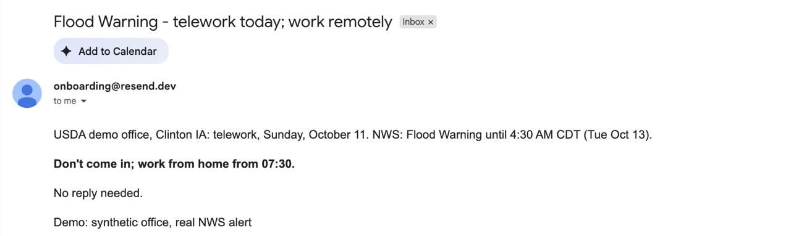
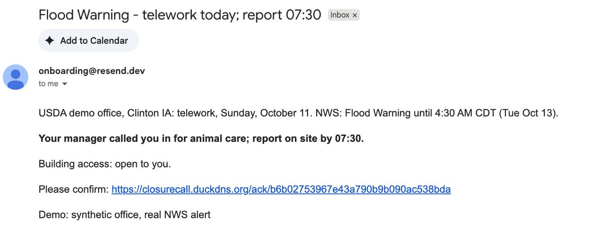

<p align="center">
  
</p>

### Make the call. Reach the right people. Keep the reasons.

**[Try the live app](https://closurecall.duckdns.org/facility)** · [Live national alerts](https://closurecall.duckdns.org/national) · [Thresholds and citations](https://closurecall.duckdns.org/thresholds) · [Decision record](https://closurecall.duckdns.org/record)

It’s 4 a.m. Severe weather is approaching, and employees will soon leave home. A facility manager must decide: **open normally, delay, dismiss early, offer telework or close?**

The answer is scattered across weather alerts, road reports and employee schedules. Closure Call brings that evidence together so the manager can make an informed decision and communicate it before the commute begins.

> **Agents investigate. Code applies documented rules. A human makes the final call.**

Built for the **USDA Closure Call**, **AWS Best Use of Strands Agents SDK**, and **Akamai Cloud AI** challenges at [Hack Midwest](https://hackmidwest.com/).

## Start here: 

Use the **facility manager** demo role. This is a prototype with synthetic employee records and a role switcher.

1. **Show real NWS data.** Open [National scan](https://closurecall.duckdns.org/national), refresh, and select a located active alert. Inspect its source, timestamps, severity, certainty and urgency. This evaluates a temporary facility; it does not have an employee roster.
2. **Show the complete facility workflow.** Open [Facility](https://closurecall.duckdns.org/facility), choose the seeded Kansas City demo facility and evaluate a target operating day. Show the graded recommendation, threshold observations and margins, confidence, missing data and what would change the result. Wait for preliminary local checks to finish before deciding.
3. **Show agents doing work.** Follow the agent activity panel and ask an investigation question such as “Is the access road still closed?” Inspect the supporting evidence and any revised recommendation. 
4. **Approve and notify.** Open [Decide](https://closurecall.duckdns.org/decide), approve or override with a reason, then inspect who is included or excluded, their instructions and channel routing. Send to configured demo recipients and show an actual receipt and acknowledgment. Unconfigured channels are not successful deliveries.
5. **Show accountability.** Open [Record](https://closurecall.duckdns.org/record), reconstruct the decision, inspect a saved evidence copy, verify its hash and open the printable decision memo. Follow a threshold link to its citation and facility-policy justification.

<!-- **Live evidence and scenario playback are separate.** Use the national scan for the required real-alert demonstration even if Kansas City has calm weather. A labeled simulated winter scenario or saved replay can demonstrate the roster workflow, but does not replace the live NWS requirement. -->

## How it works


*Solid arrows show the workflow. Dashed arrows show information saved to the decision record.*

1. Gather weather and supplementary evidence alongside facility details and employee schedules.
2. Apply documented rules and explain the recommendation, uncertainty and alternatives.
3. Let the manager investigate further before making the decision.
4. Record the decision and send instructions appropriate to each affected person.
5. Preserve the evidence, reasoning, decision and notification outcomes.

An onsite employee may need a new reporting time. Someone on leave may need no routine alert. Essential staff receive instructions specific to their responsibilities. Assignments, details, telework status, accessibility needs and commute timing inform the notification plan.

<!-- The main demonstration uses a **synthetic USDA Kansas City field office**, focusing on wind/severe-weather and flooding/access disruption. A national scan demonstrates live evidence at other locations; it is not a claim that every facility or hazard is fully modeled. -->

<!-- ## USDA: the five deliverables

| Required deliverable | What Closure Call implements | Where to inspect it |
| --- | --- | --- |
| **Working system with live NWS data** | Calls the actual NWS API for alerts and forecasts; combines it with supplementary road and local signals, plus river checks during investigation | [National scan](https://closurecall.duckdns.org/national), [NWS client](../backend/app/sources/nws.py), [source documentation](../docs/sources.md) |
| **Recommendation with reasoning** | Normal, delayed arrival, early dismissal, telework or closure; source-linked and timestamped evidence; observed values, thresholds and numeric margins where applicable; confidence, what would change the result and a plain-language rationale | [Rules engine](../backend/app/rules/engine.py), [recommendation view](../frontend/src/components/RecommendationView.tsx) |
| **Notification package** | Recipient inclusion/exclusion reasons, drafted instructions, push/email routing, notification timing, acknowledgment and escalation | [Notification plan](../backend/app/notify/plan.py), [delivery channels](../backend/app/notify/channels.py), Decide and Teams pages |
| **Reconstructable decision record** | Saved evidence, evaluation and decision history, overrides, delivery outcomes, hash verification and printable decision memos | [Decision-record documentation](../docs/decision-record.md), [record implementation](../backend/app/record.py) |
| **Defensible thresholds** | Versioned policy, structured source citations, published hazard definitions and explicit justification for the prototype’s response choices | [Thresholds page](https://closurecall.duckdns.org/thresholds), [policy YAML](../backend/app/rules/thresholds.yaml), [facility policy](../docs/facility-policy.md) |

Official hazard definitions inform the thresholds; **facility policy determines the proposed response**. These response mappings are prototype choices, not official USDA directives. News alone does not trigger closure, and missing data is marked unknown. Verification of a source definition does not imply agency endorsement of our response. -->
## USDA: the five deliverables

Choose the **Facility manager** demo role. Start by evaluating a facility, then follow its recommendation through approval, notification and the decision record.

| USDA deliverable | How we implement it | Explore the live app |
| --- | --- | --- |
| **1. Working system with live NWS data** | Retrieve real weather alerts and forecasts, alongside supplementary local evidence. | [National scan](https://closurecall.duckdns.org/national) · [Facility evaluation](https://closurecall.duckdns.org/facility) |
| **2. Recommendation with reasoning** | Show the recommended operating status, supporting evidence, timestamps, threshold comparisons, confidence and what would change the recommendation. Managers can ask follow-up questions before deciding. | [Facility recommendation](https://closurecall.duckdns.org/facility) |
| **3. Notification package** | Review recipient inclusion and exclusion reasons, drafted instructions and delivery channels. After approval, track employee responses. | [Decide and notify](https://closurecall.duckdns.org/decide) · [Team responses](https://closurecall.duckdns.org/team) |
| **4. Reconstructable decision record** | Preserve evidence, recommendations, manager decisions and notification outcomes. Inspect saved evidence and printable decision memos. | [Decision record](https://closurecall.duckdns.org/record) |
| **5. Defensible thresholds** | Show policy versions, source citations and the justification connecting hazard conditions to a proposed operating status. | [Thresholds and citations](https://closurecall.duckdns.org/thresholds) |

<!-- **Official sources define hazards; our prototype facility policy defines the proposed response.** The manager makes the final decision. These mappings are not official USDA directives.

*National scan demonstrates live alerts. Use the seeded facility to demonstrate the employee notification workflow; temporary national-scan facilities do not have an employee roster.* -->
### One decision, different instructions

A facility-wide telework decision does not mean everyone receives the same message. These demo emails show how Closure Call communicates each employee’s responsibilities.

**Remote-work instruction:** Stay home and begin work at 07:30.



**Manager-authorized call-in:** Report onsite for animal care at 07:30, with building-access information and a confirmation link.



*Demo emails for a synthetic office in Clinton, Iowa, referencing a real NWS flood alert.*
## AWS: how we use Strands Agents SDK


**Strands provides the agent framework. Akamai provides the AI inference.** 

| Agent | Role in the workflow |
| --- | --- |
| **Weather** | Calls Python tools exposed with `@tool` to fetch and store evidence, then returns relevance notes and uncertainty flags |
| **Local coordinator and specialists** | Select and analyze relevant roads, schools, public-safety and news items; Python validates the extracted facts |
| **Investigator** | Uses bounded tools to check access, commutes, river conditions and local closures, or explains saved evidence in response to manager questions |
| **Writer and message agents** | Draft explanations and recipient-group wording from validated facts; code retains control of recommendations, recipients and instructions |

Our custom **agent harness** adds execution context, structured output models, call budgets, rate limiting, timeouts, result validation and audit hooks. Failed calls or rejected drafts fall back to direct fetching, code-based extraction or templates as appropriate. 

The distinctive workflow connects **manager questions → tool-based investigation → validated evidence → a rules-based revision → human review**, while preserving the reasons and employee-specific consequences.


## Akamai: cloud hosting and AI inference

The project’s cloud deployment uses **Akamai Cloud hosting and the Akamai workshop AI inference endpoint**.

<!-- 
| Judging area | Project contribution and evidence |
| --- | --- |
| **Impact and usefulness** | Helps managers act before employee commutes, communicate individual duties and retain a reconstructable decision record |
| **Powered by Akamai** | Cloud-hosted application and AI inference through the model adapter; production Compose and [server setup](../scripts/server_setup.sh) define the hosting setup |
| **Technical execution** | Frontend/backend CI checks, persisted evidence, validated AI outputs, fallbacks, health reporting and deployment rollback logic |
| **Creativity and innovation** | Combines interactive investigation, employee-aware notification planning and verifiable saved evidence around a human decision | -->


## CI/CD and deployment


CI runs backend tests, frontend tests and the frontend build on pushes and pull requests. Deployment can run after successful CI on a push to `main`.

The deployment connects over SSH. Docker builds React and packages it with FastAPI; Caddy forwards public traffic and supports HTTPS for a configured domain. A failed deployment health gate triggers an attempt to restore the previous code version.


The deployment script currently fetches the latest `main`, rather than pinning the exact CI-tested commit.

<!-- ## Run locally

<!-- Prerequisites: Docker with a recent Docker Compose v2. Run from the repository root (the parent of this `backend` directory): -->

```sh
cp .env.example .env
# Edit .env with your Akamai workshop credentials and NWS contact User-Agent.
docker compose up --build
```

### Tests

```sh
# Backend: Python 3.11, from backend/
python -m venv .venv
source .venv/bin/activate
pip install -r requirements.txt
python -m pytest -q
```

```sh
# Frontend: Node 20, from frontend/ (matching CI)
npm ci
npm test
npm run build
```

<!-- Backend tests use a temporary SQLite database and block calls to the live workshop inference endpoint. Test coverage includes rules, agents, recipient planning, investigations, saved copies and record integrity. Live NWS, inference and notification delivery must also be demonstrated separately. -->


## Documentation and resources

[Architecture](../docs/architecture.md) · [Decision record and printable memos](../docs/decision-record.md) · [Facility policy](../docs/facility-policy.md) · [Data sources](../docs/sources.md) · [Design before/after](../docs/design-pass.md)

[Hack Midwest challenges](https://hackmidwest.com/) · [Strands SDK](https://github.com/strands-agents/sdk-python) · [Akamai starter kit](https://github.com/akamai-developers/akamai-workshop-hackmidwest) · [NWS API](https://www.weather.gov/documentation/services-web-api) · [NOAA water API](https://water.noaa.gov/about/api)
